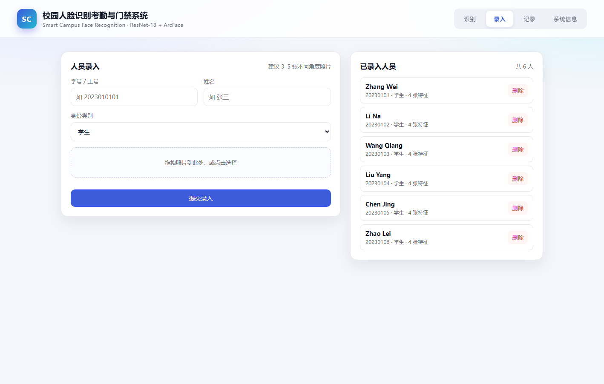
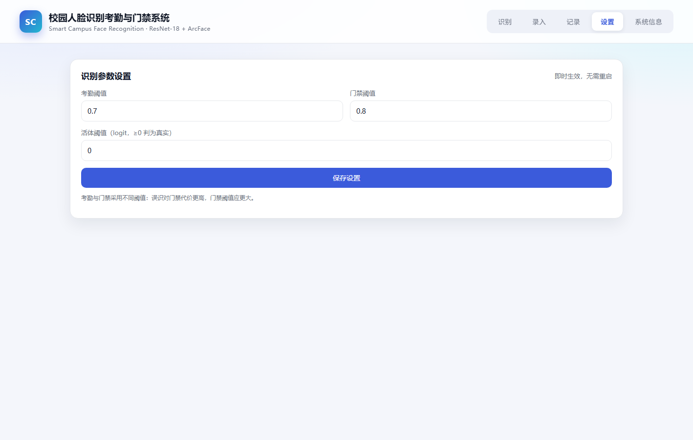
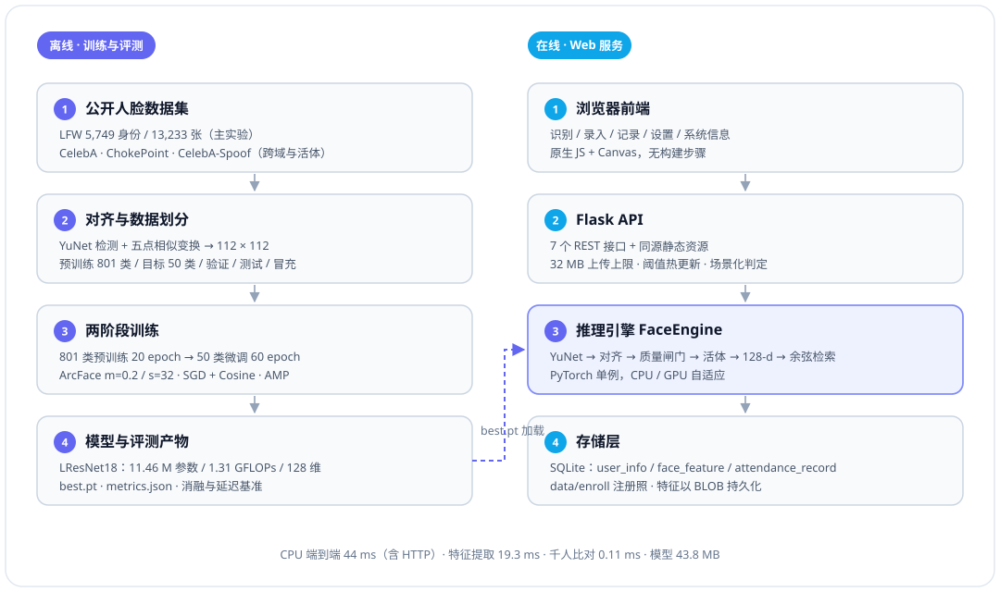
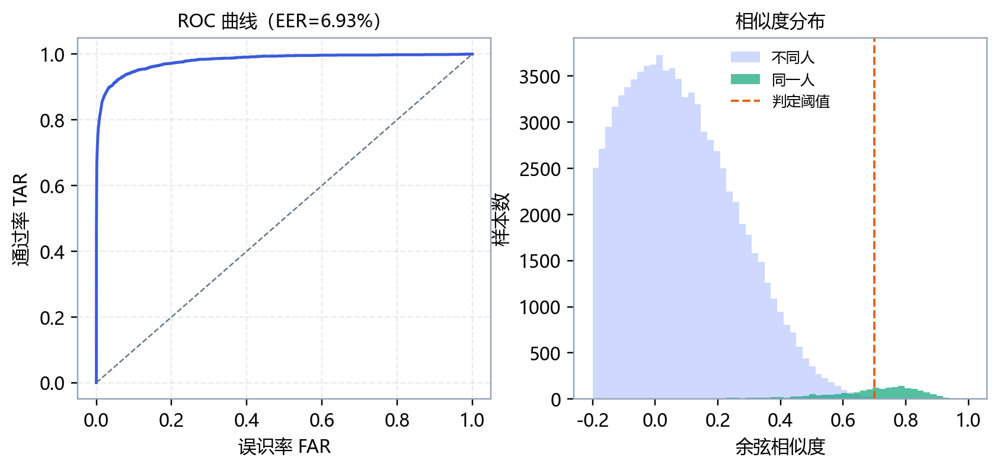
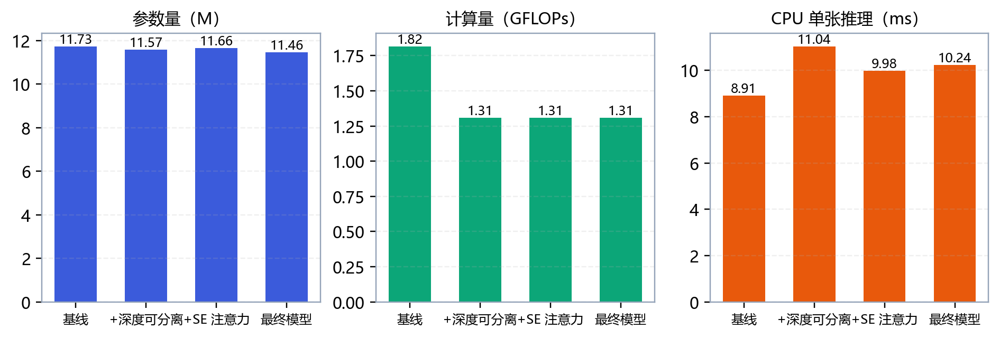
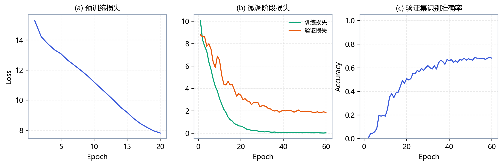

<div align="center">

# 校园人脸识别考勤与门禁系统

**Smart Campus Face Recognition · ResNet-18 + ArcFace · Flask + Vanilla JS**

用一套可复现的深度学习流水线，把「人脸检测 → 对齐 → 活体 → 特征提取 → 向量检索 → 考勤入库」做成能在普通 CPU 上跑起来的完整 Web 系统。

[](https://www.python.org/)
[](https://pytorch.org/)
[](https://flask.palletsprojects.com/)
[](https://opencv.org/)
[](.github/workflows/ci.yml)
[](LICENSE)


</div>

---

## 目录

- [项目亮点](#项目亮点)
- [功能一览](#功能一览)
- [界面预览](#界面预览)
- [系统架构](#系统架构)
- [识别链路与延迟](#识别链路与延迟)
- [模型设计](#模型设计)
- [实验结果](#实验结果)
- [快速开始](#快速开始)
- [训练与评测](#训练与评测)
- [HTTP API](#http-api)
- [目录结构](#目录结构)
- [设计取舍与已知局限](#设计取舍与已知局限)
- [文档与许可](#文档与许可)

---

## 项目亮点

| | |
|---|---|
| **精度** | LFW 50 身份封闭集 **Rank-1 84.13%**，成对验证准确率 **99.02%**，EER **6.93%** |
| **轻量** | 自研 LResNet18 仅 **11.46 M 参数 / 1.31 GFLOPs**，比 ResNet-18 基线减少 **28%** 计算量，嵌入维度 128 维 |
| **实时** | CPU 端到端 **44.2 ms**（含 HTTP），1000 人底库比对 **0.11 ms** |
| **完整** | 检测、对齐、质量闸门、活体、检索、考勤记录全链路打通，前端 5 个页面 + 7 个 REST 接口 + SQLite 持久化 |
| **可复现** | 数据准备、两阶段训练、评测、消融、延迟基准、论文绘图脚本与全部指标 JSON 随仓库提供，`pytest` + GitHub Actions CI |

> 项目定位不是「又一个 LFW 刷分脚本」，而是**可部署的人脸识别系统**：所有指标都能用仓库内脚本复现，所有接口都能用 `curl` 验证。

## 功能一览

| 模块 | 能力 |
|---|---|
| 实时识别 | 浏览器摄像头抓帧或上传照片，一次请求返回身份、相似度、阈值、活体分数与耗时 |
| 活体检测 | 0.1 M 参数轻量 CNN，拦截照片/屏幕翻拍，未通过直接拒绝并写入拦截记录 |
| 质量闸门 | 人脸框 < 48 px 或 Laplacian 方差 < 25（模糊）时拒绝识别，避免"低质量硬判" |
| 人员录入 | 学号/工号 + 姓名 + 身份类别，支持 3–5 张多角度照片，特征取均值后入库 |
| 记录与统计 | 今日识别、累计记录、通过次数、注册人数、近 7 日趋势、可按条数查询明细 |
| 场景化阈值 | 考勤 0.70 / 门禁 0.80 双阈值，可在设置页热更新，无需重启服务 |
| 模型自检 | `/api/health` 返回设备、权重路径、底库规模、活体开关，便于现场排障 |
| 工程化 | GitHub Actions 跑单元测试、Dockerfile/docker-compose 一键部署、环境变量可覆盖全部路径 |

## 界面预览

<div align="center">
  
  
</div>

左：多图录入与已录入人员管理；右：考勤/门禁/活体阈值在线调整，保存即生效。

## 系统架构

<div align="center">
  
</div>

离线侧完成「公开数据集 → 对齐与划分 → 两阶段训练 → 权重与指标」；在线侧前端只负责采集与展示，Flask 承担协议与业务，`FaceEngine` 单例持有检测器、识别模型与底库矩阵，SQLite 负责用户、特征与记录三类数据。

## 识别链路与延迟

| 阶段 | 实现 | 说明 |
|---|---|---|
| 1. 采集 | `getUserMedia` 960×720，Canvas 编码 JPEG(q=0.92) | 也可 `multipart/form-data` 上传 |
| 2. 检测 | OpenCV YuNet（0.22 MB ONNX，320×320 输入） | 取置信度最高的人脸框 |
| 3. 对齐 | 五点 `estimateAffinePartial2D` → 112×112 | 采用 ArcFace 标准五点模板 |
| 4. 质量闸门 | 人脸框 ≥ 48 px、Laplacian 方差 ≥ 25 | 不达标直接返回可读原因 |
| 5. 活体 | 轻量 CNN 输出 logit，与阈值比较 | 未通过则记 `passed=0` 并拦截 |
| 6. 特征 | LResNet18 → 128 维，L2 归一化 | 归一化后余弦相似度 = 点积 |
| 7. 检索 | 底库矩阵 `(N,128)` 与特征做一次矩阵乘，`argmax` | 1000 人 0.11 ms |
| 8. 决策与入库 | 按场景选阈值，写 `attendance_record` | 返回完整判定依据 |

**实测（CPU，40 次请求）**：端到端平均 **44.21 ms**，中位数 46.06 ms，P95 51.8 ms；其中特征提取（检测 + 对齐 + 前向）**19.29 ms**，千人比对 **0.1088 ms**。耗时数据见 `experiments/metrics.json`，复测脚本为 `code/scripts/measure_latency.py`。

## 模型设计

**骨干网络**（`code/face_recog/models.py`）：以 ResNet-18 为蓝本做了三处改造——

| 组件 | 设计 | 动机 |
|---|---|---|
| Depthwise Separable Conv | 深度卷积 + 点卷积 + BN + PReLU，只替换前两个 stage | 浅层特征图分辨率高，是算力瓶颈；深层保留标准卷积以维持表达力 |
| SE Block | 1×1 压缩（reduction=16）+ Sigmoid 激励 | 让通道响应自适应，抑制遮挡/光照造成的无效通道 |
| Embedding Head | BN → Dropout(0.4) → GAP → FC(512) → BN → PReLU → FC(128) → BN | 128 维降低底库内存与比对开销，双 FC 提升类内紧凑性 |

**损失函数**：ArcFace（加性角度间隔），`scale=32`、`margin=0.2`。

$$
L=-\log\frac{e^{s\cos(\theta_{y}+m)}}{e^{s\cos(\theta_{y}+m)}+\sum_{j\neq y}e^{s\cos\theta_{j}}}
$$

> 选型过程：先按论文默认 `m=0.5, s=64` 训练，50 类小样本下梯度被 margin 压制、loss 几乎不降；把 margin 降到 0.2、scale 降到 32 后收敛正常。这条经验写进了 `docs/PROJECT.md` 的「难点与解决」。

**两阶段训练**：先在 801 个身份、3955 张图上做粗粒度预训练，再在 50 个目标身份、1316 张图上微调。

| 阶段 | 类别数 | 图像数 | Epoch | Batch | LR | 最优验证准确率 | 耗时 |
|---|---|---|---|---|---|---|---|
| 预训练 | 801 | 3955 | 20 | 64 | 0.02 | 30.0% | 279.9 s |
| 微调 | 50 | 1316 | 60 | 32 | 0.005 | 68.79% | 357.2 s |

优化器 SGD（momentum 0.9，Nesterov）+ CosineAnnealing，权重衰减 5e-4，CUDA 下开启 AMP。数据增广：水平翻转、±10° 旋转、亮度/对比度扰动、高斯模糊、Cutout。

## 实验结果

**主实验（LFW 50 身份，250 底库 / 416 探针 / 250 冒充）**

| 指标 | 数值 |
|---|---|
| Rank-1 准确率 | **84.13%** |
| 成对验证准确率 | **99.02%** |
| EER | **6.93%** |
| TAR @ FAR=1e-3 / 1e-2 / 1e-1 | 64.90% / 81.92% / 94.66% |
| 冒充集误接受率（阈值 0.70） | 14.8% |
| 本人误拒绝率（阈值 0.70） | 32.0% |

**消融实验（统一 50 类、30 epoch、相同增广）**

| 变体 | 参数量 | FLOPs | Rank-1 | EER |
|---|---|---|---|---|
| baseline（标准 ResNet-18，512 维） | 11.73 M | 1.82 G | 85.10% | 6.98% |
| + DS 卷积 | 11.57 M | 1.31 G | **85.34%** | 7.13% |
| + DS + SE | 11.66 M | 1.31 G | 83.65% | 7.48% |
| full（DS + SE + 128 维） | 11.46 M | 1.31 G | 79.57% | 9.30% |

结论：**DS 卷积是"精度不掉、算力降 28%"的主要贡献**；SE 在小样本下无正收益；128 维单阶段训练掉 5.7 个点，但配合预训练 + 60 epoch 微调后回到 84.13%，说明表征容量需要足够训练量支撑。

**跨数据集与活体**

| 场景 | 设置 | Rank-1 | EER |
|---|---|---|---|
| CelebA | 零样本（90 身份 / 420 图） | 13.0% | 41.4% |
| ChokePoint | 零样本 | 48.1% | 35.9% |
| ChokePoint | 目标域微调（20 人 / 7097 帧） | **99.95%** | **0.043%** |
| CelebA-Spoof | 活体二分类（真实/攻击各 500） | Acc **90.6%** | EER 8.6% |

<div align="center">
  
  
</div>

<div align="center">
  
</div>

完整图表与复现命令见 [`docs/RESULTS.md`](docs/RESULTS.md)。

## 快速开始

**环境**：Python 3.10/3.11（Windows / Linux / macOS 均可），无需 GPU。

```bash
git clone https://github.com/<your-name>/campus-face-recognition.git
cd campus-face-recognition

python -m venv .venv
# Windows: .venv\Scripts\activate
source .venv/bin/activate

# 仅 CPU 时建议先装 CPU 版 PyTorch
pip install torch==2.2.2 torchvision==0.17.2 --index-url https://download.pytorch.org/whl/cpu
pip install -r requirements.txt

python code/backend/app.py
```

打开 <http://127.0.0.1:5000>：

1. 进入 **录入** 页，填写学号/姓名/身份类别，上传 3–5 张不同角度照片并提交；
2. 返回 **识别** 页，点击「开启摄像头」→「拍照识别」，或直接「上传照片」；
3. 在 **记录** 页查看考勤明细与统计，在 **设置** 页调整考勤/门禁阈值。

> 仓库已附带训练好的权重 `experiments/runs/finetune_full/best.pt`（43.8 MB）与活体模型 `experiments/runs/liveness/best.pt`，开箱即可识别。首次启动会自动创建 `data/campus_face.db`。

**Docker 部署**

```bash
docker compose up --build
# 服务地址 http://127.0.0.1:5000，data/ 通过 volume 持久化
```

**常用环境变量**（全部可选）

| 变量 | 默认值 | 作用 |
|---|---|---|
| `FACE_APP_HOST` / `FACE_APP_PORT` | `127.0.0.1` / `5000` | 监听地址与端口 |
| `FACE_APP_CHECKPOINT` | `experiments/runs/finetune_full/best.pt` | 识别模型权重 |
| `FACE_APP_LIVENESS` | `experiments/runs/liveness/best.pt` | 活体模型权重（缺失则自动关闭活体） |
| `FACE_APP_DB` | `data/campus_face.db` | SQLite 路径 |
| `FACE_APP_CONFIG` | `data/config.json` | 阈值配置文件 |

## 训练与评测

```bash
# 1. 数据准备：从 LFW parquet 解析身份、YuNet 对齐到 112×112，并生成划分
python code/scripts/prepare_data.py --parquet data/lfw/lfw_data.parquet --out data/aligned

# 2. 阶段一：801 类预训练
python code/scripts/train.py --stage pretrain --epochs 20 --lr 0.02 --batch 64 --tag pretrain_full

# 3. 阶段二：50 类微调（从预训练权重初始化）
python code/scripts/train.py --stage finetune --init experiments/runs/pretrain_full/best.pt \
    --epochs 60 --lr 0.005 --batch 32 --tag finetune_full

# 4. 评测（Rank-1 / 验证准确率 / EER / TAR@FAR / 端到端延迟）
python code/scripts/evaluate.py --ckpt experiments/runs/finetune_full/best.pt

# 5. 消融与基准
python code/scripts/run_ablation.py
python code/scripts/benchmark.py

# 6. 活体检测训练
python code/liveness/train.py --manifest data/spoof/manifest.csv --epochs 10 --out experiments/runs/liveness
```

数据来源：LFW（HuggingFace `vilsonrodrigues/lfw` parquet 版）、CelebA、ChokePoint、CelebA-Spoof，均只用于学术研究。`data/` 与训练日志不入库，按上述命令本地重建。

## HTTP API

| 方法 | 路径 | 说明 |
|---|---|---|
| `GET` | `/api/health` | 服务状态、设备、阈值、底库规模、权重路径 |
| `POST` | `/api/recognize` | 识别一张图（`image` + `scene`），返回身份、分数、活体与耗时 |
| `POST` | `/api/enroll` | 录入人员（`user_id`/`name`/`category` + `images[]`） |
| `GET` | `/api/users` | 已录入人员及特征数 |
| `DELETE` | `/api/users/<user_id>` | 删除人员及其特征 |
| `GET` | `/api/records?limit=100` | 识别记录（上限 500） |
| `GET` | `/api/stats` | 注册人数、今日识别、累计记录、通过次数（7 日趋势由前端聚合） |
| `GET`/`PUT` | `/api/config` | 读取/更新考勤、门禁、活体阈值 |

```bash
curl -X POST http://127.0.0.1:5000/api/recognize \
  -F "image=@face.jpg" -F "scene=门禁"
```

```json
{
  "success": true, "passed": true, "score": 0.8734, "threshold": 0.8,
  "liveness": 4.21, "liveness_pass": true,
  "user": {"user_id": "20230104", "name": "Liu Yang", "category": "学生"},
  "elapsed_ms": 45.7, "match_ms": 0.12
}
```

字段语义、错误码与完整示例见 [`docs/API.md`](docs/API.md)。

## 目录结构

```
.
├── code/
│   ├── backend/            # Flask 应用、SQLite 数据层、推理引擎、阈值配置
│   ├── face_recog/         # 模型、对齐、ArcFace 损失、数据集、评测指标
│   ├── frontend/           # 原生 HTML/CSS/JS 单页应用（无构建步骤）
│   ├── liveness/           # 活体检测模型与训练脚本
│   ├── scripts/            # 数据准备、训练、评测、消融、延迟、绘图
│   └── models/             # YuNet 人脸检测 ONNX 模型
├── experiments/
│   ├── figures/            # 论文与 README 图表
│   ├── runs/               # 训练产物（含随仓库发布的 best.pt）
│   └── *.json              # metrics / ablation / benchmark / liveness 指标
├── tests/                  # pytest：模型、指标、API
├── docs/                   # 项目文档（项目详解 / API / 结果 / 发布说明）
├── .github/workflows/ci.yml
├── Dockerfile · docker-compose.yml · requirements*.txt
└── README.md
```

## 设计取舍与已知局限

在写简历和答辩之前，这些边界值得先讲清楚——它们同时也是面试追问的入口。

- **评测协议是封闭集**：底库每人 5 张，且这 5 张同时属于微调训练集，因此 84.13% 的 Rank-1 反映的是「已注册人员的再识别」，**不能**与 LFW 6000 对验证的 99% 直接比较。
- **开集能力有限**：零样本跨域仅 13.0%（CelebA）/ 48.1%（ChokePoint），说明模型对未见过的人脸分布泛化不足。系统的产品化路径是「按点注册 + 目标域微调」，ChokePoint 微调后可达 99.95%。
- **阈值偏保守**：0.70 阈值下本人误拒绝率 32%，换来冒充集 14.8% 的误接受率；门禁场景用 0.80 进一步收紧。没有做大规模阈值标定，实际部署应基于业务 FAR 目标重新校准。
- **活体是单帧二分类**：90.6% 准确率无法抵御高质量 3D 面具或深度伪造视频，工业级方案需引入多帧时序、红外/深度或动作挑战。
- **工程侧简化**：SQLite 单文件、Flask 单进程、无鉴权与限流，适合课程/演示与内网小規模场景；生产化需要换 PostgreSQL、加 JWT、上 WSGI/容器编排，并把特征检索换成 FAISS。
- **隐私**：仓库不含任何真实校园人脸数据，示例截图使用公开数据集与虚构学号；实际部署须遵循《个人信息保护法》，做到告知同意、最小化采集与加密存储。

改进路线（带目标值）与 16 道面试问答整理在 [`docs/PROJECT.md`](docs/PROJECT.md)。

## 文档与许可

| 文档 | 内容 |
|---|---|
| [`docs/PROJECT.md`](docs/PROJECT.md) | 简历导向的项目详解：一页速览、中英简历 bullet、技术方案、5 个 STAR 难点、面试 Q&A |
| [`docs/RESULTS.md`](docs/RESULTS.md) | 全部实验指标、图表说明、复现命令与数据来源 |
| [`docs/API.md`](docs/API.md) | 7 个接口的请求/响应、错误分支与 `curl` 示例 |
| [`docs/PUBLISH.md`](docs/PUBLISH.md) | 发布到 GitHub 的步骤、体积策略与仓库设置建议 |

代码以 [MIT License](LICENSE) 开源；LFW / CelebA / ChokePoint / CelebA-Spoof 数据集遵循各自原始许可，仅用于非商业研究。若本项目对你的研究或课程有帮助，欢迎 Star ⭐。
