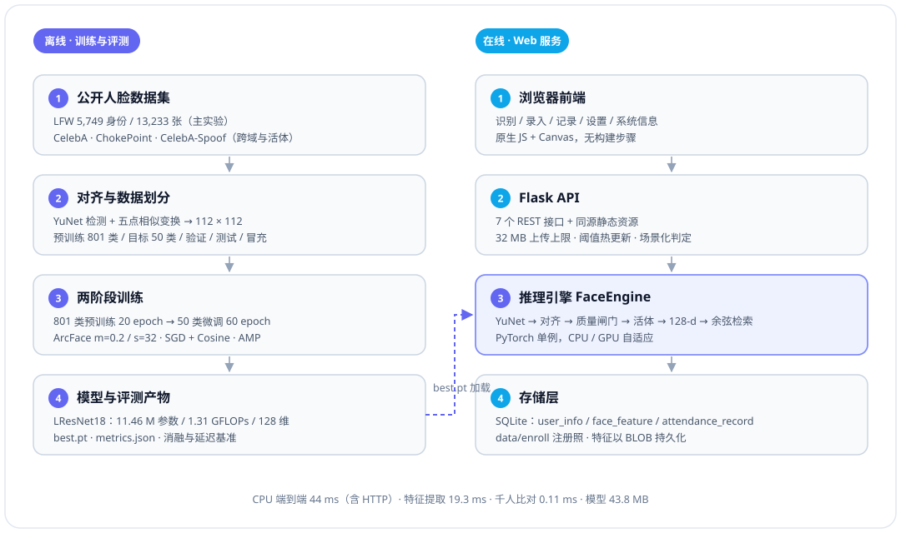

<div align="center">

# Smart Campus Face Recognition

**Attendance & access control with ResNet-18 + ArcFace · Flask + vanilla JS · 44 ms end-to-end on CPU**

[](https://www.python.org/)
[](https://pytorch.org/)
[](https://flask.palletsprojects.com/)
[](LICENSE)


</div>

A complete, reproducible face-recognition system: detection → five-point alignment → quality gate → liveness → 128-d embedding → cosine gallery search → attendance record, served through a Flask API and a five-page web UI.

> 中文主文档见 [README.md](README.md)。

## Highlights

| Aspect | Result |
|---|---|
| **Accuracy** | Rank-1 **84.13%** on a 50-identity LFW closed set; pairwise verification **99.02%**; EER **6.93%** |
| **Efficiency** | 11.46 M params / 1.31 GFLOPs (−28% vs. ResNet-18 baseline), 128-d embeddings |
| **Latency** | **44.2 ms** end-to-end on CPU including HTTP; **0.11 ms** to match against 1,000 identities |
| **Engineering** | 7 REST endpoints, SQLite persistence, liveness gating, hot-reloadable scene thresholds, pytest + GitHub Actions CI, Docker |

## Architecture

<div align="center">
  
</div>

Offline: dataset → alignment and splits → two-stage training → checkpoint and metrics.
Online: browser UI → Flask API → `FaceEngine` (detector, model, gallery matrix) → SQLite.

## Results

| Setting | Rank-1 | EER |
|---|---|---|
| LFW, 50 identities (250 gallery / 416 probe) | 84.13% | 6.93% |
| Ablation: ResNet-18 baseline | 85.10% | 6.98% |
| Ablation: + depthwise separable conv | 85.34% | 7.13% |
| ChokePoint, target-domain fine-tune | 99.95% | 0.043% |
| CelebA-Spoof liveness (binary) | 90.6% acc | 8.6% |

Full tables and figures: [docs/RESULTS.md](docs/RESULTS.md).

## Quick start

```bash
git clone https://github.com/<your-name>/campus-face-recognition.git
cd campus-face-recognition
python -m venv .venv && source .venv/bin/activate
pip install torch==2.2.2 torchvision==0.17.2 --index-url https://download.pytorch.org/whl/cpu
pip install -r requirements.txt
python code/backend/app.py          # http://127.0.0.1:5000
```

Pretrained weights (`best.pt`, 43.8 MB) ship with the repo. Enroll 3–5 photos per person on the **录入** page, then recognize from the webcam or an upload.

Docker: `docker compose up --build`.

## Repository layout

```
code/backend      Flask app, SQLite layer, inference engine, runtime config
code/face_recog   LResNet18, YuNet alignment, ArcFace loss, dataset, metrics
code/frontend     Single-page UI (no build step)
code/liveness     Lightweight liveness CNN and training script
code/scripts      Data prep, training, evaluation, ablation, latency, plots
experiments       Metrics JSON, figures, checkpoints
tests             pytest: model shapes, metrics, API contract
docs              Project deep dive, API reference, results, publishing guide
```

## Known limitations

Closed-set protocol with gallery images also present in fine-tuning data; weak open-set generalisation (13.0% / 48.1% zero-shot cross-domain); single-frame liveness; SQLite + single-process Flask without auth. See [docs/PROJECT.md](docs/PROJECT.md) for the discussion and roadmap.

## License

MIT. Datasets (LFW, CelebA, ChokePoint, CelebA-Spoof) keep their original research-only licenses. No real campus face data is included.
