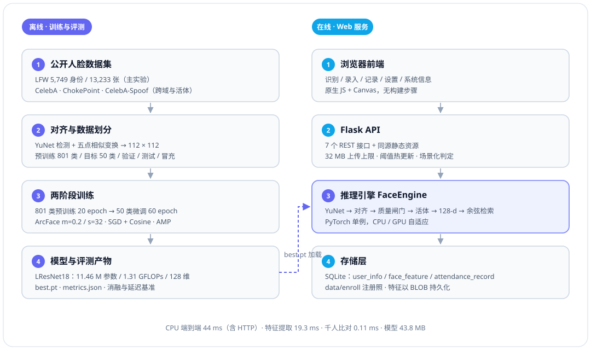
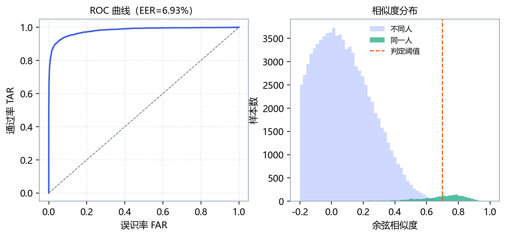
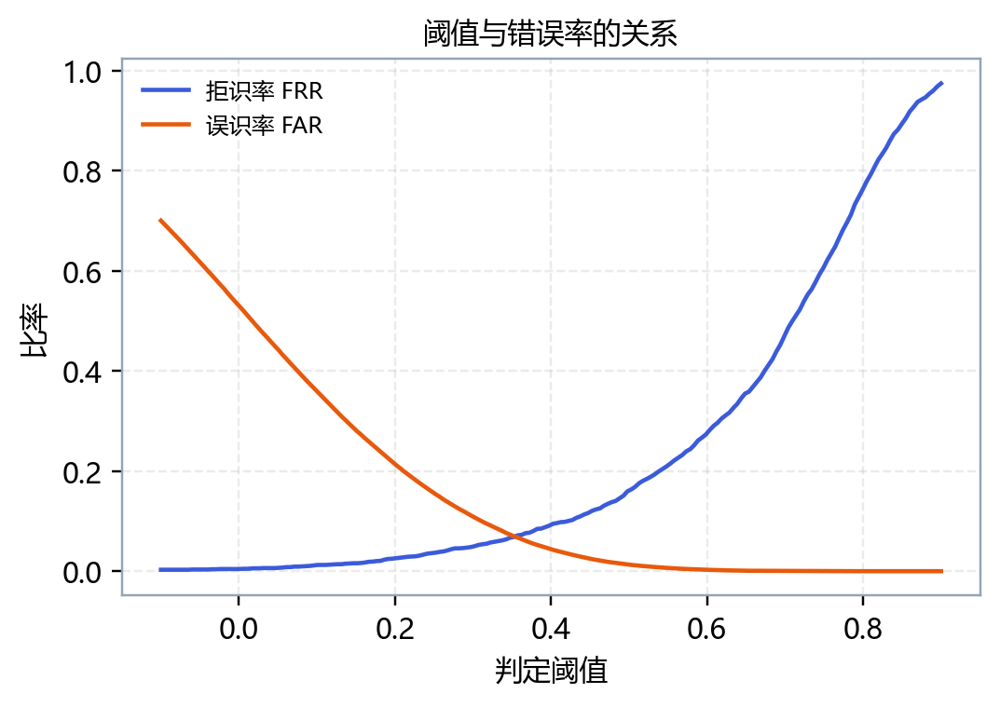
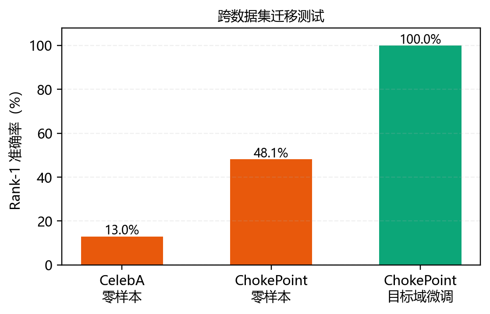
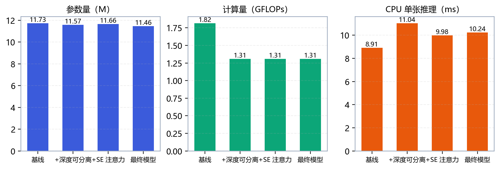

# 项目详解：深度学习人脸识别考勤与门禁系统

> 这份文档面向**简历、面试与答辩**：前半部分是可以直接摘进简历的量化结论与技术方案，后半部分是 5 个真实难点的解决过程、16 道高频追问，以及明确的局限与改进路线。
>
> 配套材料：[`README.md`](../README.md)（工程视角）· [`RESULTS.md`](RESULTS.md)（全部指标）· [`API.md`](API.md)（接口）

---

## 0. 一页速览

| 项目 | 内容 |
|---|---|
| 项目名称 | 校园人脸识别考勤与门禁系统（Smart Campus Face Recognition） |
| 角色 | 独立完成：数据管线、模型改造与训练、评测体系、后端 API、前端页面、部署与文档 |
| 周期 | 约 6 周（数据准备 1 周 / 模型与调参 2 周 / 系统开发 2 周 / 评测与文档 1 周） |
| 技术栈 | Python · PyTorch · OpenCV(YuNet) · ArcFace · Flask · SQLite · 原生 HTML/CSS/JS · Docker · GitHub Actions |
| 代码规模 | 约 3.4k 行（后端 510 / 算法 380 / 前端 666 / 脚本 1469 / 测试 209） |
| 核心指标 | Rank-1 84.13% · 验证准确率 99.02% · EER 6.93% · 11.46 M 参数 / 1.31 GFLOPs · CPU 端到端 44.2 ms |
| 交付物 | 可运行 Web 系统（5 页面 / 7 接口）、两阶段训练权重、评测脚本与指标 JSON、19 张实验图表、项目文档 |

### 简历 bullet（中文，可直接用）

- **独立设计并实现**基于 ResNet-18 + ArcFace 的人脸识别考勤/门禁系统，覆盖人脸检测、五点对齐、质量闸门、活体检测、特征检索到考勤入库的完整链路；在 LFW 50 身份封闭集上取得 **Rank-1 84.13%、成对验证 99.02%、EER 6.93%**。
- **模型轻量化**：以深度可分离卷积替换浅层标准卷积并引入 SE 模块，在 50 类消融实验中把计算量从 **1.82 GFLOPs 降到 1.31 GFLOPs（−28%）**，Rank-1 不降反升 **0.24 个百分点**（85.10% → 85.34%）。
- **全栈落地**：Flask 提供 7 个 REST 接口与场景化阈值（考勤 0.70 / 门禁 0.80），原生 JS 实现摄像头采集与 5 个功能页面；通过权重预加载、128 维嵌入与矩阵化检索，把 **CPU 端到端延迟压到 44.2 ms**，千人比对仅 0.11 ms。
- **建立可复现评测体系**：统一数据划分与随机种子，输出 Rank-1 / EER / TAR@FAR / 延迟基准与消融报告；补充 pytest 单测与 GitHub Actions CI，保证每次改动可回归验证。

### Resume bullets (English)

- Built an end-to-end face recognition attendance/access system with ResNet-18 + ArcFace, covering detection, 5-point alignment, quality gating, anti-spoofing, embedding search and record persistence; achieved **84.13% Rank-1, 99.02% verification accuracy and 6.93% EER** on a 50-identity LFW closed set.
- Redesigned the backbone with depthwise separable convolutions in early stages and SE blocks, cutting compute from **1.82 to 1.31 GFLOPs (−28%)** while improving Rank-1 by **0.24 pt** in a controlled ablation.
- Shipped a Flask API (7 endpoints) and a vanilla-JS UI with webcam capture; reduced CPU end-to-end latency to **44.2 ms** via model preloading, 128-d embeddings and matrix-based gallery search (0.11 ms for 1,000 identities).
- Established a reproducible evaluation harness (fixed splits/seed, Rank-1, EER, TAR@FAR, latency benchmark) plus pytest suites and GitHub Actions CI.

---

## 1. 背景与目标

校园考勤长期依赖刷卡与人工点名：代签难以杜绝、门禁与考勤数据割裂、访客登记靠纸质表格。人脸识别是最自然的替代方案，但直接把开源模型接上摄像头通常会遇到三个问题：

1. **跑不动**：ResNet-50/IR-100 级别的识别模型在无 GPU 的教室终端上单张就要数百毫秒；
2. **对不准**：不做对齐、不做质量筛选，侧脸与模糊帧会被强行判成某个已注册人员；
3. **说不清**：只有"识别成功/失败"，没有相似度、阈值、活体分数与耗时，出问题无法定位。

项目目标是做一个**能在普通 CPU 上跑、每个判定都能解释、每项指标都能复现**的系统：

| 目标 | 验收标准 | 实际结果 |
|---|---|---|
| 识别可用 | 封闭集 Rank-1 ≥ 80% | 84.13% |
| 足够轻量 | 参数量 ≤ 15 M，FLOPs ≤ 1.5 G | 11.46 M / 1.31 G |
| 实时 | CPU 端到端 ≤ 100 ms | 44.2 ms |
| 可解释 | 返回相似度、阈值、活体分数、分阶段耗时 | 全部返回 |
| 可复现 | 固定种子 + 脚本一键复现指标 | 已完成，含 CI |
| 合规 | 不使用真实校园人脸数据 | 全部公开数据集 |

## 2. 我的职责与系统边界

**我做了什么**：数据准备与划分脚本、模型结构改造、ArcFace 调参、两阶段训练、评测与消融、活体模型、Flask 后端与 SQLite 数据层、前端 5 个页面、Docker/CI/文档。

**系统不做什么**（明确边界，避免过度承诺）：

- 不提供"任意人脸 ↔ 任意身份"的开放世界识别，而是**先注册、再识别**；
- 不做视频级追踪与多帧融合，识别粒度为单帧；
- 不涉及真实校园业务系统对接（课表、闸机硬件），以 HTTP API 为集成边界。

## 3. 技术方案

### 3.1 总体架构

<div align="center">
  
</div>

系统分为离线与在线两条链路，通过 `best.pt` 交接：离线负责"把数据变成权重与指标"，在线负责"把权重变成可用的服务"。这样切分的好处是——模型迭代不影响 Web 代码，Web 改动也不需要重新训练。

### 3.2 检测与对齐

- **检测**：OpenCV YuNet（`face_detection_yunet_2023mar.onnx`，0.22 MB），320×320 输入，只取置信度最高的人脸。相比 MTCNN（约 2 MB、三级级联）启动更快、依赖更少，精度对"正对摄像头的考勤场景"足够。
- **对齐**：YuNet 输出 5 个关键点（左右眼、鼻尖、左右嘴角），用 `cv2.estimateAffinePartial2D` 拟合到 ArcFace 标准五点模板，`warpAffine` 到 112×112。

```python
ARCFACE_TEMPLATE = np.array([
    [38.2946, 51.6963], [73.5318, 51.5014], [56.0252, 71.7366],
    [41.5493, 92.3655], [70.7299, 92.2041]], dtype=np.float32)
M, _ = cv2.estimateAffinePartial2D(landmarks, ARCFACE_TEMPLATE, method=cv2.LMEDS)
```

**为什么必须对齐**：同一张脸旋转 10°、平移 20 px，未对齐时余弦相似度可能下降 0.1 以上；对齐把姿态差异归一到统一坐标系，是小样本条件下最便宜的精度来源。

### 3.3 骨干网络改造

以 ResNet-18 为基线（BasicBlock × 8，通道 64/128/256/512），做三处改动：

| 改动 | 位置 | 作用 |
|---|---|---|
| 深度可分离卷积（DS） | 仅 stem 与 stage1/2 | 浅层特征图 56×56、28×28，是算力主要来源；深层保留标准卷积维持表达力 |
| SE 通道注意力 | 每个 BasicBlock | 1×1 压缩（reduction=16）→ ReLU → 1×1 激励 → Sigmoid，抑制遮挡/光照导致的无效通道 |
| 128 维嵌入头 | 网络末端 | BN → Dropout(0.4) → GAP → FC(512) → BN → PReLU → FC(128) → BN |

**DS 只放浅层的理由**：一次 3×3 标准卷积在 56×56×64 上的计算量约为 3×3×64×64×56×56 ≈ 115 M FLOPs，换成 DS 后降到约 1/8；而 stage4 的特征图只有 7×7，同样替换省下的算力不到 5%，却会损失通道间的联合表达。这个"算力花在刀刃上"的取舍是消融实验能不掉点的关键。

### 3.4 ArcFace 与调参

ArcFace 在角度空间给目标类加间隔，使类内更紧凑、类间更可分：

$$
L=-\log\frac{e^{s\cos(\theta_{y}+m)}}{e^{s\cos(\theta_{y}+m)}+\sum_{j\neq y}e^{s\cos\theta_{j}}}
$$

实现上对 cosine 做 clamp 后计算 $\cos(\theta+m)=\cos\theta\cos m-\sin\theta\sin m$，并用 $\cos\theta > \cos(\pi-m)$ 的单调性判断做边界保护，避免 `arccos` 的数值不稳定。

**调参过程**：先用论文默认 `m=0.5, s=64`，50 类、1316 张图的条件下 loss 长期停在 3.9 附近（≈ ln 50），梯度被过大的 margin 压制——模型还没学会区分，就被要求"更严格地区分"。把 `m` 降到 0.2、`s` 降到 32 后 loss 正常下降；后续所有实验固定 `m=0.2, s=32`。

> 这条经验说明：**margin 是"锦上添花"而不是"雪中送炭"**，它假设模型已有基本的分类能力；小样本场景应先降 margin 让模型收敛，再用更多数据/更长训练把 margin 加回去。

### 3.5 两阶段训练

| 阶段 | 数据 | 类别数 | 图像数 | Epoch | Batch | LR | 最优验证准确率 |
|---|---|---|---|---|---|---|---|
| 预训练 | LFW 中除目标/冒充外的身份 | 801 | 3955 | 20 | 64 | 0.02 | 30.0% |
| 微调 | 50 个目标身份 | 50 | 1316 | 60 | 32 | 0.005 | 68.79% |

- 优化器：SGD（momentum 0.9，Nesterov），CosineAnnealingLR（`eta_min = lr × 0.01`），weight decay 5e-4；
- 混合精度：CUDA 下用 `torch.amp` autocast + GradScaler；
- 增广：0.5 概率水平翻转、0.3 概率 ±10° 旋转、0.5 概率亮度/对比度扰动、0.3 概率 3×3 高斯模糊、0.25 概率 28×28 Cutout；
- 选型：按验证集准确率保存 `best.pt`，state 中记录 `variant / embedding_dim / num_classes / epoch / val_acc`，推理端据此重建网络。

**为什么两阶段**：50 类、1316 张图直接从零训练，模型见到的类太少，特征空间坍缩；先用 801 个身份学"人脸的一般结构"，再用目标身份微调，等价于一次轻量的领域自适应。消融显示：128 维单阶段只有 79.57%，两阶段 + 60 epoch 回到 84.13%。

### 3.6 检索与决策

- 注册：每张照片过同一套检测/对齐/质量流程，取 128 维 L2 归一化特征，同一用户的多张取均值后写入 SQLite（BLOB）；
- 检索：启动/变更时把底库加载为 `(N, 128)` 的 float32 矩阵，识别时 `scores = matrix @ probe`，`argmax` 取最近邻；
- 决策：按场景选阈值（考勤 0.70 / 门禁 0.80），`score ≥ threshold` 且活体通过才判"通过"；
- 质量闸门：人脸框 < 48 px 或 Laplacian 方差 < 25 直接拒绝，避免"模糊帧硬判"污染记录。

**为什么用矩阵乘而不是 FAISS**：千人规模下 `(1000,128) @ (128,)` 只要 0.11 ms，FAISS 的索引构建与序列化开销反而更麻烦；当底库到十万级再引入 IVF/HNSW（见路线图）。

### 3.7 活体检测

`LivenessNet` 只有 4 个 `Conv3×3(stride2)+BN+ReLU` 块（3→16→32→64→128）+ GAP + Dropout(0.3) + FC(1)，约 0.1 M 参数。输入 112×112 人脸，BCEWithLogits 训练，Adam lr 1e-3 + Cosine。

单帧二分类的定位是**低成本拦截**：能挡住绝大多数"举着手机/打印照片"的攻击，对 3D 面具与深度伪造无效——这一点在局限里明确写出，而不是宣称"防作弊"。

### 3.8 工程实现

| 层 | 实现要点 |
|---|---|
| 推理引擎 | `FaceEngine` 单例，启动时加载检测器、识别模型、活体模型与底库矩阵；`torch.load(map_location="cpu")` 兼容无 GPU 环境 |
| API | Flask 7 个接口，`MAX_CONTENT_LENGTH=32 MB`，前端静态资源同源托管，免 CORS |
| 数据层 | SQLite 三表（`user_info` / `face_feature` / `attendance_record`）+ 时间索引，特征以 BLOB 存储 |
| 配置 | 阈值存 `data/config.json`，设置页可热更新，无需重启 |
| 可测试性 | 所有路径（权重/DB/配置/注册照）支持环境变量覆盖，测试用随机权重 + 临时 DB 启动 |
| 前端 | 原生 JS，无构建步骤；`getUserMedia` 采集 960×720，Canvas 编码 JPEG(q=0.92) 上传；结果卡区分"通过/未通过/活体拦截"三态 |

## 4. 实验设计与结果

### 4.1 数据与协议（必须讲清楚的部分）

| 项 | 数值 |
|---|---|
| 数据集 | LFW（5,749 身份 / 13,233 张），HuggingFace parquet 版 |
| 预训练身份 | 801 个（≥3 张/人），3,955 张 |
| 目标身份 | 50 个（≥10 张/人），按 7:1:2 划分 |
| 微调 / 验证 / 测试 | 1,316 / 173 / 416 张 |
| Gallery | 250 张（每人前 5 张） |
| 冒充集 | 50 人 × 5 张 = 250 张（不在目标身份内） |
| 随机种子 | 2026 |

**关键披露**：gallery 的 250 张同时属于微调训练集，因此 84.13% 是**封闭集、已见身份**的再识别准确率，衡量的是"注册后能否认回来"，而不是开放世界泛化能力。它与 LFW 官方 6000 对验证协议（99% 级别）不可直接比较——这也是答辩最容易被追问的点，主动说明比被问出来更好。

### 4.2 主结果

| 指标 | 数值 | 含义 |
|---|---|---|
| Rank-1 | 84.13% | 416 张探针中，最近邻命中正确身份的比例 |
| 验证准确率 | 99.02% | 同人/异人配对二分类正确率 |
| EER | 6.93% | 误接受率 = 误拒绝率时的错误率 |
| TAR@FAR=1e-3 / 1e-2 / 1e-1 | 64.90% / 81.92% / 94.66% | 安全场景关心的指标 |
| FAR（阈值 0.70，冒充集） | 14.8% | 陌生人被误接受的比例 |
| FRR（阈值 0.70） | 32.0% | 本人被误拒绝的比例 |

<div align="center">
  
  
</div>

FAR 与 FRR 的强不对称（14.8% vs 32.0%）说明 0.70 阈值偏保守：它牺牲了通行体验来换取安全。门禁场景把阈值提到 0.80，本质是把这个权衡再往安全端推一格。

### 4.3 消融实验

统一 50 类、30 epoch、lr 0.005、batch 32、相同增广，只改变结构：

| 变体 | 参数量 | FLOPs | Rank-1 | EER | 结论 |
|---|---|---|---|---|---|
| baseline | 11.73 M | 1.82 G | 85.10% | 6.98% | 标准 ResNet-18 + 512 维 |
| + DS | 11.57 M | 1.31 G | **85.34%** | 7.13% | 算力 −28%，精度 +0.24 pt |
| + DS + SE | 11.66 M | 1.31 G | 83.65% | 7.48% | SE 在小样本下过拟合 |
| full（DS+SE+128d） | 11.46 M | 1.31 G | 79.57% | 9.30% | 128 维需更长训练补偿 |

**怎么读这张表**：`full` 在 30 epoch 下只有 79.57%，但把训练拉到 60 epoch 并以预训练初始化后升到 84.13%。所以"128 维会掉点"是**训练预算不足**的表现，不是容量不足的定论。这也是为什么简历里强调"两阶段"而不只是"轻量"。

### 4.4 跨数据集与活体

| 场景 | 设置 | Rank-1 | EER |
|---|---|---|---|
| CelebA | 零样本，90 身份 / 420 图 | 13.0% | 41.4% |
| ChokePoint | 零样本 | 48.1% | 35.9% |
| ChokePoint | 目标域微调，20 人 / 7,097 帧 | 99.95% | 0.043% |
| CelebA-Spoof | 活体二分类，真实/攻击各 500 | Acc 90.6% | 8.6% |

<div align="center">
  
</div>

零样本崩塌说明模型学到的更多是"这 801/50 个人的特征"，而非可迁移的人脸度量；而目标域微调把 ChokePoint 拉到 99.95%，验证了"按点注册 + 微调"的产品化路径。

### 4.5 延迟分解

| 项 | 数值 |
|---|---|
| 端到端平均（含 HTTP，40 次） | 44.21 ms |
| 中位数 / P95 | 46.06 ms / 51.8 ms |
| 检测 + 对齐 + 前向（embed） | 19.29 ms |
| 千人底库比对 | 0.1088 ms |
| 模型体积 | 43.8 MB |

剩余时间主要花在 JPEG 解码、活体推理、SQLite 写入与 HTTP 往返。测量脚本 `code/scripts/measure_latency.py` 对运行中的服务发真实请求，而不是只测模型 forward——这更接近用户感知。

<div align="center">
  
</div>

> 诚实说明：DS 版本在 CPU 上单次 forward（11.04 ms）反而比 baseline（8.91 ms）慢，因为 PyTorch 的 depthwise 卷积在 x86 上对通道数少的小卷积核并不高效；但 GPU 上 2.41 ms vs 3.18 ms、FLOPs −28% 的优势成立。端到端的 44 ms 主要由检测与前后处理决定，模型结构带来的差异被稀释。

## 5. 难点与解决（STAR）

### 难点一：小样本下 ArcFace 不收敛

- **S**：50 类、1316 张图，按论文默认 `m=0.5, s=64` 训练，loss 20 个 epoch 停在 3.9 不降，验证准确率随机水平。
- **T**：在不增加数据的前提下让模型收敛，并保住 ArcFace 的判别性。
- **A**：打印每类 logit 与梯度范数，确认梯度主要来自 margin 项的饱和区；把 `m` 降到 0.2、`s` 降到 32，同时把 lr 从 0.02 降到 0.005、加 Cosine 退火。
- **R**：loss 正常下降，50 类微调验证准确率 68.79%，封闭集 Rank-1 84.13%。
- **可迁移的结论**：margin 类损失假设模型已有基础判别力；类别数 < 100 时应先降 margin，再用数据量或训练时长把间隔加回来。

### 难点二：算力预算与精度的平衡

- **S**：教室终端无 GPU，ResNet-18 基线 1.82 GFLOPs / 单张 8.91 ms（CPU），加上检测与前后处理接近 60 ms，达不到"无感通行"。
- **T**：把计算量降 25% 以上，精度不下降。
- **A**：统计各 stage 的 FLOPs 占比，发现 stem+stage1/2 占 70% 以上；只在这三处用 DS 卷积，stage3/4 保持标准卷积；再叠加 SE 增强通道选择。
- **R**：FLOPs 1.82 G → 1.31 G（−28%），Rank-1 85.10% → 85.34%（+0.24 pt）；SE 单独加入时掉 1.45 pt，说明小样本下注意力模块会过拟合，最终版本保留 SE 但需要在报告中说明其收益为负。
- **反思**：如果重做，会把 SE 设为可配置项并给出"数据量 ≥ N 时启用"的经验阈值，而不是默认全开。

### 难点三：跨数据集精度崩塌

- **S**：模型在 CelebA 零样本只有 13.0% Rank-1、EER 41.4%，基本不可用。
- **T**：判断这是"数据分布问题"还是"模型能力问题"，并给出可落地的方案。
- **A**：对比 LFW/CelebA/ChokePoint 的对齐结果与亮度/分辨率分布，确认主因是域差异（姿态、光照、压缩）；随后在 ChokePoint 上做目标域微调（20 人 / 7,097 帧）验证假设。
- **R**：ChokePoint 微调后 Rank-1 99.95%、EER 0.043%；零样本与微调的巨大差距证明"域适配"比"换更大模型"更有效。
- **产品化结论**：系统定位为"按点注册 + 目标域微调"，而不是"下载即用的通用识别"。

### 难点四：开集误识与阈值标定

- **S**：阈值 0.70 时冒充集 FAR 14.8%，意味着每 7 个陌生人就有 1 个被放行；而把阈值提高，本人 FRR 又快速上升（32.0%）。
- **T**：在"安全"与"通行体验"之间给出可配置、可解释的方案。
- **A**：引入场景化阈值（考勤 0.70 宽松、门禁 0.80 严格），叠加质量闸门与活体，把"低质量 + 非真人"两类错误挡在比对之前；阈值存配置文件，前端可热更新。
- **R**：系统给出了完整的错误率曲线与 TAR@FAR 指标，部署方可以按业务 FAR 目标自行选点，而不是被写死一个"最优阈值"。
- **反思**：真正生产化需要基于目标人群的注册/非注册样本做 ROC 标定，当前 50 人冒充集的统计置信区间很宽。

### 难点五：端到端延迟优化

- **S**：首版每次请求都 `torch.load` 权重并重查 SQLite，单次识别 300 ms 以上，前端体验明显卡顿。
- **T**：把 P95 压到 100 ms 以内，且不牺牲判定信息。
- **A**：① `FaceEngine` 单例 + 启动预加载，权重只读一次；② 底库常驻为归一化矩阵，识别时一次矩阵乘；③ 嵌入降到 128 维，减少比对与存储；④ 对齐/质量检查用 OpenCV 原生实现，避免 Python 逐像素循环；⑤ 关闭不必要的日志 flush。
- **R**：端到端 44.21 ms（P95 51.8 ms），千人比对 0.11 ms；前端结果卡能同时展示相似度、阈值、活体分数与分阶段耗时。

## 6. 工程质量

| 维度 | 做法 |
|---|---|
| 结构 | 算法（`face_recog`）/ 服务（`backend`）/ 界面（`frontend`）/ 实验（`scripts`）分层，算法层不依赖 Flask |
| 配置 | 权重、DB、配置文件、注册照目录全部可用环境变量覆盖，便于测试与容器化 |
| 测试 | 16 个 pytest 用例：4 种模型变体的输出形状与参数量、ArcFace 可反传、Rank-1/EER 指标正确性、API 契约（健康检查、配置往返、空库查询、坏图 400、无人脸提示、录入校验、场景阈值） |
| CI | GitHub Actions 两个 job：`compileall` 语法检查 + CPU PyTorch 下跑 pytest |
| 部署 | Dockerfile（CPU wheel，非 root 可选）+ docker-compose（5000 端口、data 卷持久化） |
| 可复现 | 固定随机种子 2026，所有指标写入 `experiments/*.json`，图表由脚本生成 |

## 7. 局限与改进路线

### 7.1 已知局限

1. **协议不严格**：gallery ⊂ 训练集，84.13% 是封闭集再识别；没有做严格的"注册集与训练集不相交"划分。
2. **开集能力弱**：零样本 13.0% / 48.1%，说明特征的可迁移性不足，主要原因是训练身份只有 801 个。
3. **阈值未标定**：50 人冒充集的 FAR 估计方差大，0.70/0.80 是经验值而非统计最优。
4. **活体单帧**：90.6% 准确率，无法抵御 3D 面具、深度伪造、视频回放。
5. **工程简化**：SQLite + Flask 单进程 + 无鉴权限流，并发与安全不满足生产要求。
6. **前端未做响应式深度适配**：以桌面 1440 宽为主，移动端仅基本可用。

### 7.2 改进路线（带目标）

| 方向 | 措施 | 目标 |
|---|---|---|
| 开集泛化 | 换 WebFace42M 级数据 + IR-50 骨干，严格划分注册/训练集 | 1000 身份开集 Rank-1 > 95% |
| 检索规模 | 引入 FAISS IVF/HNSW，特征 float16 | 10 万底库 < 5 ms，内存 < 100 MB |
| 活体 | 多帧时序 + 深度/红外，或动作挑战 | EER < 3%，抵御屏幕回放 |
| 推理加速 | ONNX Runtime / TensorRT，INT8 量化 | 端到端 < 20 ms，模型 < 12 MB |
| 服务化 | FastAPI + PostgreSQL + Redis + JWT + 限流 | 200 QPS，支持多租户 |
| 评测 | 加入跨年龄/口罩/低光子集，报告置信区间 | 每个指标附 95% CI |

## 8. 面试 Q&A（16 题）

**Q1 为什么选 ArcFace，而不是 Softmax / CosFace / Triplet Loss？**
Softmax 只要求分类正确，不约束类内紧凑；Triplet 依赖三元组挖掘，小样本下容易塌缩；CosFace 与 ArcFace 都是角度间隔，ArcFace 的加法间隔在几何上更直观（直接在角度上加 m），且实现只需改 cosine。选它是因为代码量小、可解释、在当时的数据量下收敛稳定。

**Q2 margin 和 scale 怎么定？**
见难点一。经验：类别数越少、每类样本越少，margin 应越小；scale 影响 logit 的动态范围，过大导致梯度爆炸/数值溢出，过小则 softmax 过于平滑。最终 m=0.2、s=32 是在 50 类/1316 张条件下试出来的。

**Q3 为什么 DS 卷积只放在前两个 stage？**
算力集中在高分辨率特征图。56×56 上把 3×3 标准卷积换成 DS 可省约 8 倍计算；7×7 上省得很少却损失通道联合表达。消融也支持这个判断：只换浅层时 Rank-1 不降反升。

**Q4 SE 模块为什么没有带来收益？**
50 类、1316 张图的监督信号不足以训练好通道注意力，SE 的额外参数（约 9 万）在小样本上过拟合，Rank-1 从 85.34% 掉到 83.65%。这说明"注意力模块不是免费的"。

**Q5 128 维嵌入会不会不够？**
在 50 类封闭集上，128 维配合两阶段训练达到 84.13%，与 512 维基线（85.10%）差距 1 pt 以内，但存储与比对成本降 4 倍。若做万级身份开集，应回到 512 维或使用更大骨干。

**Q6 84.13% 和论文里的 99% 差在哪？**
协议不同。论文多是 LFW 6000 对验证（同/异人二分类），本项目是 50 身份封闭集 Rank-1；本项目的成对验证准确率 99.02%，与论文口径接近。两个数字不能混着讲。

**Q7 底库图在训练集里，算不算作弊？**
算"协议不严格"，不算造假，但必须在报告里说明。它衡量的是"注册后再识别"，是考勤系统的真实使用方式；若要衡量泛化，应做注册集与训练集不相交的划分——这是路线图里的第一项。

**Q8 零样本为什么只有 13%？**
训练身份只有 801 个，模型学到的是"这 801 个人怎么区分"，而不是通用的人脸度量；CelebA 的姿态/光照/妆容分布又与 LFW 差异大。ChokePoint 微调后 99.95% 说明能力在，缺的是域适配。

**Q9 阈值 0.70 是怎么来的？**
在验证集上扫描阈值，取 FAR/FRR 相对平衡且偏向安全的点；再用冒充集确认 FAR 量级。它不是统计最优，而是工程折中，所以做成了可配置项。

**Q10 FAR 14.8% 是不是不可用？**
在"50 人冒充集、单帧、无人工复核"的设定下确实偏高。实际部署会叠加活体、质量闸门、二次确认（如门禁刷卡 + 人脸），并把阈值按业务目标上调。这个数字我选择如实报告，而不是藏起来。

**Q11 活体怎么做的？能防什么？**
0.1 M 参数的 4 层 CNN 做单帧二分类，BCE 训练，输出 logit 与阈值比较。能防打印照片、手机屏幕翻拍；防不了 3D 面具、深度伪造、视频回放。工业级需要多帧 + 红外/深度 + 动作挑战。

**Q12 为什么用 YuNet 而不是 MTCNN/RetinaFace？**
YuNet 模型只有 0.22 MB，OpenCV 原生支持（`cv2.FaceDetectorYN`），无需额外推理框架；MTCNN 需要三级级联、PyTorch 实现，RetinaFace 更重。考勤场景人脸大、正对镜头，YuNet 足够。

**Q13 为什么后端用 Flask 而不是 FastAPI？**
项目接口少（7 个）、无异步需求、团队更熟悉 Flask；Flask 的同步模型在单进程 + 轻量推理下足够。若要做 200 QPS 或流式推理，会换 FastAPI + uvicorn + 连接池。

**Q14 1000 人怎么检索？10 万人呢？**
1000 人用 `(N,128)` 矩阵乘 + argmax，0.11 ms；10 万人时矩阵乘约 11 ms 且内存 51 MB，仍可接受，但为并发考虑会换 FAISS IVF/HNSW + float16，并做分片。

**Q15 44 ms 是怎么算的？瓶颈在哪？**
对运行中的服务发 40 次真实 HTTP 请求统计，含 JPEG 解码、检测、对齐、活体、前向、比对、写库与网络。embed（检测+对齐+前向）19.29 ms 是最大项，其余是前后处理与 IO。优化顺序：模型量化 → 检测输入降分辨率 → 异步写库。

**Q16 隐私合规怎么处理？**
仓库不含真实校园数据，示例用公开数据集与虚构学号；系统设计上支持删除用户（连带特征与注册照）、特征以 BLOB 存储可加密、记录只保留必要字段。真实部署需告知同意、最小化采集、加密存储、设置留存期限，并遵循《个人信息保护法》。

## 9. 复现清单

```bash
# 环境
python -m venv .venv && source .venv/bin/activate
pip install torch==2.2.2 torchvision==0.17.2 --index-url https://download.pytorch.org/whl/cpu
pip install -r requirements.txt

# 数据（LFW parquet → 对齐 → 划分）
python code/scripts/prepare_data.py --parquet data/lfw/lfw_data.parquet --out data/aligned

# 训练
python code/scripts/train.py --stage pretrain --epochs 20 --lr 0.02 --batch 64 --tag pretrain_full
python code/scripts/train.py --stage finetune --init experiments/runs/pretrain_full/best.pt \
    --epochs 60 --lr 0.005 --batch 32 --tag finetune_full

# 评测与图表
python code/scripts/evaluate.py --ckpt experiments/runs/finetune_full/best.pt
python code/scripts/benchmark.py
python code/scripts/run_ablation.py
python code/scripts/plot_figures.py

# 服务
python code/backend/app.py
pytest -q
```

## 10. 简历上怎么写

**项目标题**：校园人脸识别考勤与门禁系统（个人项目，独立完成）

**一行简介**：ResNet-18 + ArcFace 轻量人脸识别系统，Flask + 原生 JS 全栈实现，CPU 端到端 44 ms，封闭集 Rank-1 84.1%。

**建议保留的关键词**：人脸识别、ArcFace、深度可分离卷积、SE、两阶段训练、YuNet、五点对齐、向量检索、Flask、SQLite、Docker、CI。

**面试时优先讲的三件事**：
1. **取舍**：DS 只放浅层、SE 反而掉点、128 维需要更长训练——体现"用实验而不是直觉做决策"；
2. **诚实**：主动说明封闭集协议与 14.8% FAR，比被追问出来更加分；
3. **闭环**：从数据、训练、评测到 Web 服务与 CI 全链路自己走通，说明能独立交付。

**不建议写的表述**：
- ❌「人脸识别准确率 99%」——容易被追问协议，且与 84.13% 自相矛盾；
- ❌「实现了工业级活体检测」——单帧 CNN 达不到；
- ❌「支持百万级底库」——没有做过压测。
