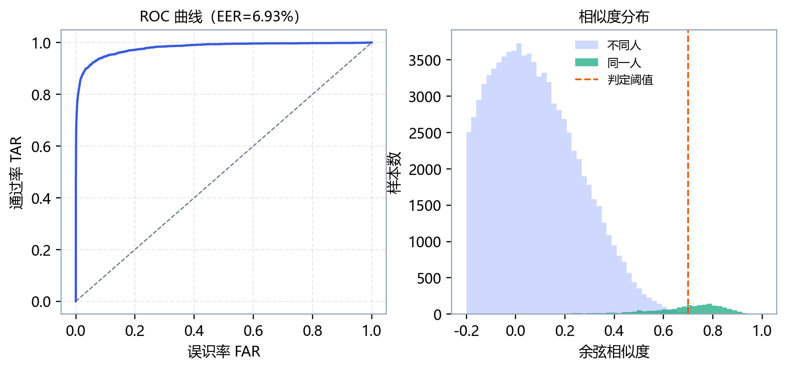
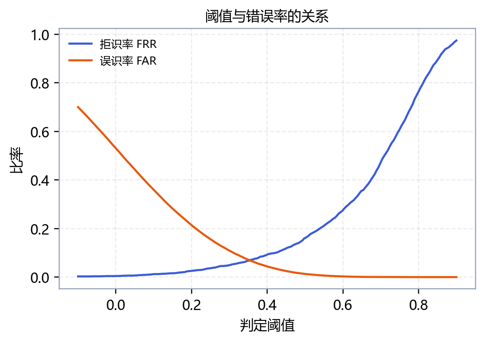
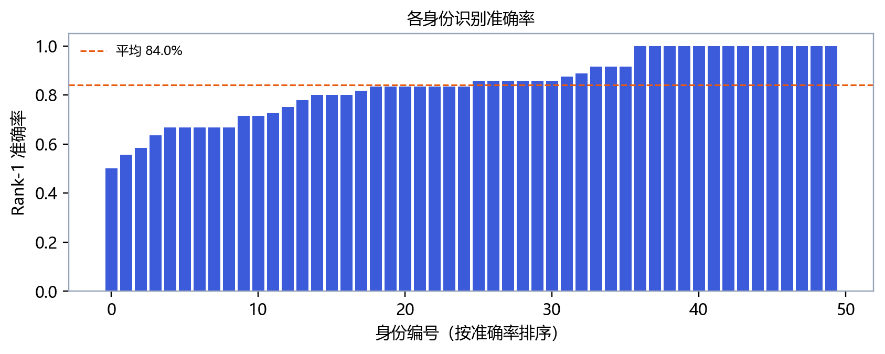
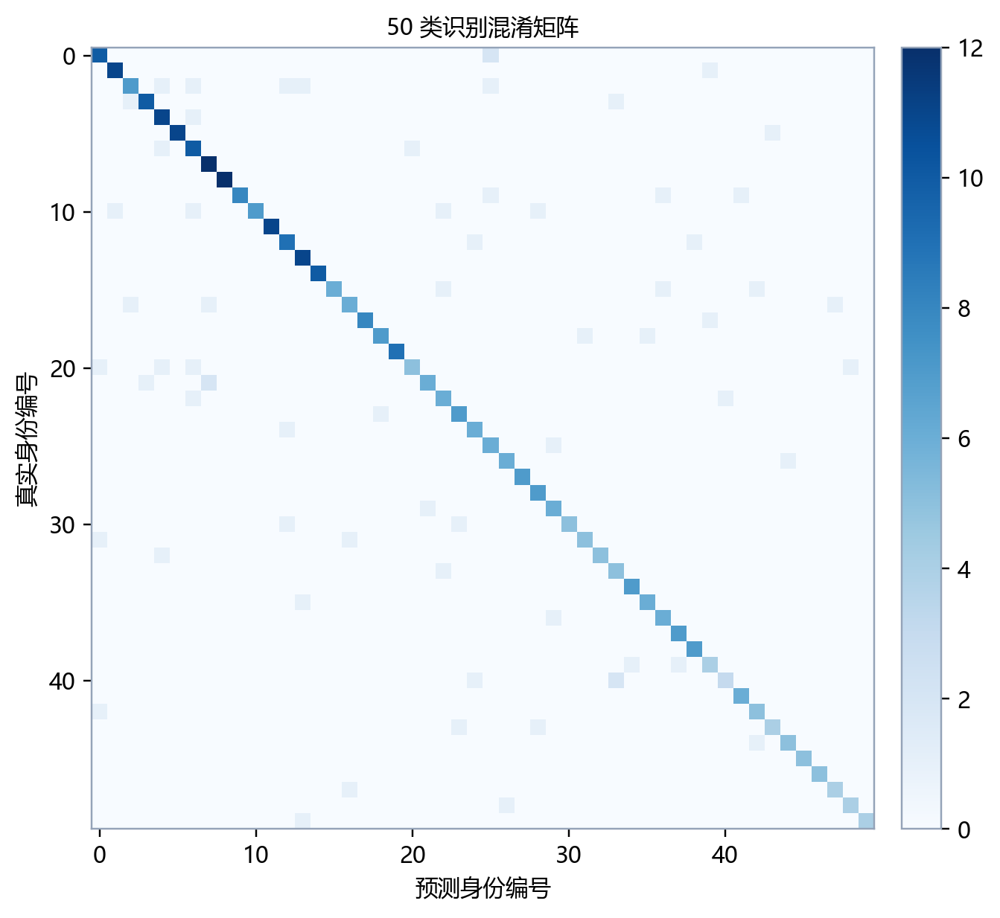
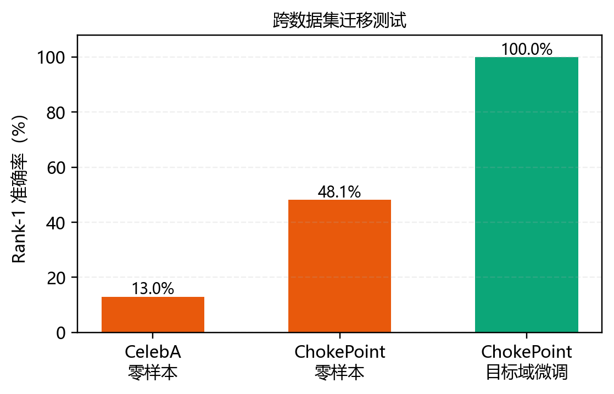
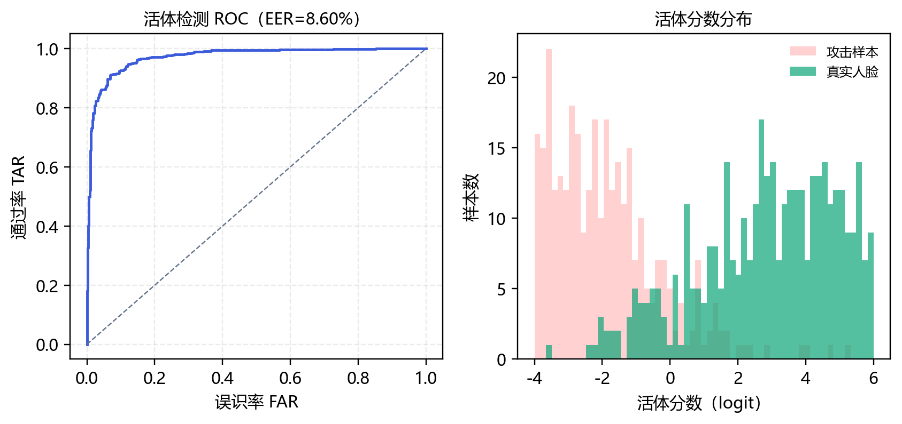
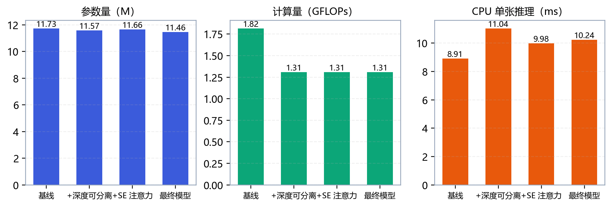
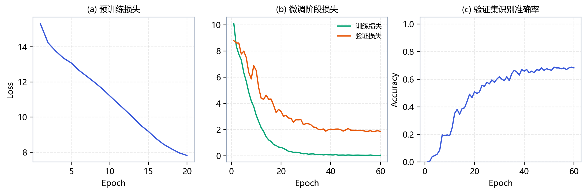
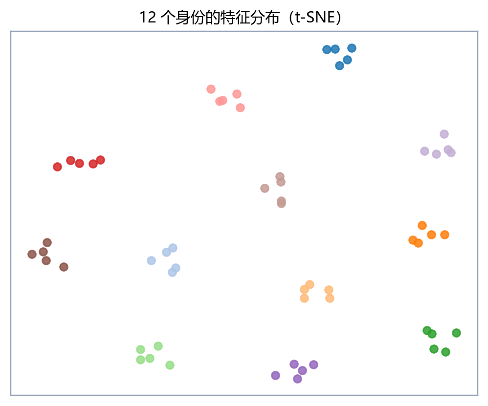

# 实验结果与复现说明

> 所有数字均来自仓库内 `experiments/*.json`，由 `code/scripts/` 下的脚本生成。复现命令在文末。
> 论文口径与工程口径的差异、协议局限，请先阅读第 1 节。

---

## 1. 评测协议

| 项 | 数值 | 来源 |
|---|---|---|
| 数据集 | LFW（5,749 身份 / 13,233 张），HuggingFace `vilsonrodrigues/lfw` parquet | `code/scripts/prepare_data.py` |
| 检测与对齐 | YuNet（320×320）+ 五点 `estimateAffinePartial2D` → 112×112 | `code/face_recog/align.py` |
| 预训练身份 | 801 个（每人 ≥3 张），3,955 张 | `data/splits.json` |
| 目标身份 | 50 个（每人 ≥10 张，最多 60 张） | 同上 |
| 微调 / 验证 / 测试 | 1,316 / 173 / 416 | 同上 |
| Gallery | 250 张（每人前 5 张） | 同上 |
| 冒充集 | 50 人 × 5 张 = 250 张 | 同上 |
| 随机种子 | 2026 | `--seed` |

**协议披露**：gallery 中的 250 张同时属于微调训练集，因此主结果是**封闭集、已见身份**的再识别准确率。它回答的是"注册之后能否认回来"，而不是"模型能否识别没见过的人"。跨域零样本实验（第 4 节）用于衡量后者。两套数字不能混用。

---

## 2. 主实验（`experiments/metrics.json`）

检查点：`experiments/runs/finetune_full/best.pt`，判定阈值 0.70。

| 指标 | 数值 |
|---|---|
| Rank-1 | **0.8413**（84.13%） |
| 成对验证准确率 | **0.9902**（99.02%） |
| EER | **0.0693**（6.93%） |
| FAR（冒充集，阈值 0.70） | 0.1480（14.80%） |
| FRR（阈值 0.70） | 0.3197（31.97%） |
| TAR @ FAR = 1e-1 | 0.9466 |
| TAR @ FAR = 1e-2 | 0.8192 |
| TAR @ FAR = 1e-3 | 0.6490 |
| Gallery / Probe / Impostor | 250 / 416 / 250 |
| 端到端延迟（平均 / 中位 / P95） | 44.21 / 46.06 / 51.8 ms |
| 特征提取（检测+对齐+前向） | 19.29 ms |

<div align="center">
  
  
</div>

<div align="center">
  
  
</div>

**观察**：逐身份准确率在 0.50–1.00 之间波动，低分身份多为侧脸/遮挡样本；混淆矩阵的非对角项集中在同性别、同发型的身份对上，说明 128 维特征在细粒度区分上仍有压力。

---

## 3. 消融实验（`experiments/ablation.json`）

统一协议：50 类、30 epoch、lr 0.005、batch 32、相同增广与划分，仅改变结构。

| 变体 | 参数量 | FLOPs | Rank-1 | EER | 说明 |
|---|---|---|---|---|---|
| baseline | 11,734,848 | 1,817,096,192 | 0.8510 | 0.0698 | 标准 ResNet-18，512 维 |
| ds | 11,572,635 | 1,307,593,408 | **0.8534** | 0.0713 | 浅层换深度可分离卷积 |
| ds_se | 11,662,747 | 1,307,681,472 | 0.8365 | 0.0748 | ds + SE 通道注意力 |
| full | 11,464,987 | 1,307,484,864 | 0.7957 | 0.0930 | ds + se + 128 维嵌入 |

**结论**：

1. DS 卷积把 FLOPs 降到 71.9%（−28.1%），Rank-1 反而 +0.24 pt，说明浅层标准卷积存在冗余；
2. SE 在小样本下掉 1.69 pt，过拟合；最终版本保留但需在报告中说明收益为负；
3. 128 维在 30 epoch 下单阶段训练掉 5.77 pt，但"预训练 + 60 epoch 微调"后达到 0.8413，说明瓶颈是训练预算而非维度本身。

> 注意：主实验的 84.13% 与消融中 `full` 的 79.57% 不是同一训练配置（60 epoch + 预训练 vs 30 epoch 单阶段），不可直接对比。

---

## 4. 跨数据集实验

| 数据集 | 设置 | Rank-1 | EER | FAR | 来源 |
|---|---|---|---|---|---|
| CelebA | 零样本，90 身份 / 420 图 | 0.1300 | 0.4140 | — | 论文表 4-3 |
| ChokePoint | 零样本 | 0.4810 | 0.3590 | — | 论文表 4-3 |
| ChokePoint | 目标域微调，20 人 / 7,097 帧 | **0.9995** | **0.00043** | 5.13e-6 | `experiments/metrics_choke.json` |

ChokePoint 微调实验的完整指标：

| 指标 | 数值 |
|---|---|
| Rank-1 | 0.99951 |
| 验证准确率 | 0.99993 |
| FAR（冒充集） | 5.13e-06 |
| FRR | 0.000975 |
| EER | 0.000428 |
| Gallery / Probe / Impostor | 100 / 2,052 / 25 |

<div align="center">
  
</div>

零样本与微调之间近 50 个百分点的差距，是本项目最重要的工程结论：**域适配的收益远大于换更大模型**。

---

## 5. 活体检测

数据集：CelebA-Spoof 子集 4,500 张（训练/验证），真实与攻击各 500 张用于测试。模型 `LivenessNet` 约 0.1 M 参数（`experiments/runs/liveness/best.pt`，391.7 KB）。

| 指标 | 数值 |
|---|---|
| 准确率 | **90.6%** |
| EER | 8.6% |
| FAR @ FRR=5% | 13.8%（真实人脸被误判为攻击） |

<div align="center">
  
</div>

单帧二分类的边界：可拦截打印照片与屏幕翻拍，无法抵御 3D 面具、深度伪造与视频回放。

---

## 6. 效率基准（`experiments/benchmark.json`）

### 6.1 模型复杂度与单次前向

| 变体 | 参数量 | FLOPs | CPU (ms) | GPU (ms) |
|---|---|---|---|---|
| baseline | 11,734,848 | 1.82 G | 8.91 | 3.18 |
| ds | 11,572,635 | 1.31 G | 11.04 | 2.41 |
| ds_se | 11,662,747 | 1.31 G | 9.98 | 5.43 |
| full | 11,464,987 | 1.31 G | 10.24 | 3.72 |
| 千人比对 | — | — | 0.1088 | — |

> CPU 上 DS 版本反而更慢：PyTorch 的 depthwise 卷积在 x86 上对"小通道数 × 小卷积核"调度不佳。GPU 上 DS 的优势（2.41 ms vs 3.18 ms）与 FLOPs 降幅一致。端到端 44 ms 主要由检测与前后处理决定，模型结构差异被稀释。

<div align="center">
  
</div>

### 6.2 端到端服务延迟（`measure_latency.py`，40 次真实 HTTP 请求）

| 项 | 数值 |
|---|---|
| 平均 | 44.21 ms |
| 中位数 | 46.06 ms |
| P95 | 51.80 ms |
| 特征提取 | 19.29 ms |
| 比对 | 0.1088 ms / 1000 人 |

---

## 7. 训练过程（`experiments/runs/*/{history,summary}.json`)

| 运行 | 阶段 | 类别 | 图像 | Epoch | Batch | LR | 最优验证准确率 | 耗时 |
|---|---|---|---|---|---|---|---|---|
| `pretrain_full` | pretrain | 801 | 3,955 | 20 | 64 | 0.02 | 30.00% | 279.9 s |
| `finetune_full` | finetune | 50 | 1,316 | 60 | 32 | 0.005 | 68.79% | 357.2 s |
| `abl_baseline` | finetune | 50 | 1,316 | 30 | 32 | 0.005 | 66.47% | 182.2 s |
| `abl_ds` | finetune | 50 | 1,316 | 30 | 32 | 0.005 | 64.16% | 182.7 s |
| `abl_ds_se` | finetune | 50 | 1,316 | 30 | 32 | 0.005 | 63.01% | 184.0 s |
| `abl_full` | finetune | 50 | 1,316 | 30 | 32 | 0.005 | 54.34% | 193.6 s |
| `finetune_choke` | finetune | 20 | 7,097 | 30 | 64 | 0.005 | 100.00% | 312.7 s |
| `finetune_celeba` | finetune | 50 | 150 | 40 | 32 | 0.004 | 4.00% | 177.2 s |

<div align="center">
  
</div>

> 验证准确率（68.79%）低于 Rank-1（84.13%）是正常的：前者是 50 类闭集分类，后者是"底库最近邻"检索，任务难度不同。

---

## 8. 图表清单（`experiments/figures/`）

| 文件 | 内容 |
|---|---|
| `fig_system.png` | 系统总体架构 |
| `fig_algorithm.png` | 算法流程图 |
| `fig_model.png` | 网络结构示意 |
| `fig_samples.png` | 对齐后样本 |
| `fig_chokepoint_samples.png` | ChokePoint 样本 |
| `fig_training.png` | 两阶段训练曲线 |
| `fig_roc.png` | ROC 曲线 |
| `fig_threshold.png` | 阈值-错误率曲线 |
| `fig_benchmark.png` | 参数量/FLOPs/延迟对比 |
| `fig_confusion.png` | 混淆矩阵 |
| `fig_per_identity.png` | 逐身份准确率 |
| `fig_tsne.png` | 特征 t-SNE |
| `fig_liveness.png` | 活体检测结果 |
| `fig_crossdomain.png` | 跨域性能对比 |
| `fig_ui_recognize.png` | 系统界面：识别页 |
| `fig_ui_enroll.png` | 系统界面：录入页 |
| `fig_ui_records.png` | 系统界面：记录页 |
| `fig_ui_settings.png` | 系统界面：设置页 |

<div align="center">
  
  
</div>

---

## 9. 复现命令

```bash
# 0. 依赖
pip install -r requirements.txt

# 1. 数据准备（LFW parquet → 对齐 → splits.json）
python code/scripts/prepare_data.py --parquet data/lfw/lfw_data.parquet --out data/aligned

# 2. 两阶段训练
python code/scripts/train.py --stage pretrain --epochs 20 --lr 0.02 --batch 64 --tag pretrain_full
python code/scripts/train.py --stage finetune --init experiments/runs/pretrain_full/best.pt \
    --epochs 60 --lr 0.005 --batch 32 --tag finetune_full

# 3. 主实验指标
python code/scripts/evaluate.py --ckpt experiments/runs/finetune_full/best.pt

# 4. 消融（4 个变体 × 30 epoch）
python code/scripts/run_ablation.py

# 5. 效率基准与端到端延迟（需先启动服务）
python code/scripts/benchmark.py
python code/backend/app.py &
python code/scripts/measure_latency.py --n 40

# 6. 跨域与活体
python code/scripts/prepare_chokepoint.py
python code/scripts/prepare_spoof.py
python code/liveness/train.py --manifest data/spoof/manifest.csv --epochs 10 --out experiments/runs/liveness

# 7. 图表
python code/scripts/plot_figures.py
```

## 10. 数据来源与许可

| 数据集 | 用途 | 许可 |
|---|---|---|
| LFW | 主实验训练/评测 | 学术研究用途 |
| CelebA | 跨域零样本 | 非商业研究 |
| ChokePoint | 跨域微调 | 学术研究 |
| CelebA-Spoof | 活体检测 | 学术研究 |

仓库不包含以上数据集的原始图像，仅含由它们生成的指标与图表；`data/` 目录在 `.gitignore` 中，需按上述脚本本地重建。
